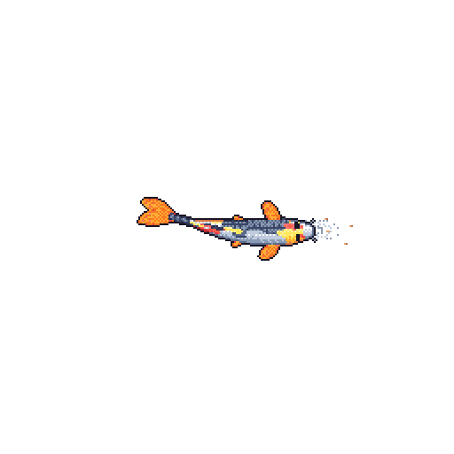

<picture>
  <source media="(prefers-color-scheme: dark)" srcset="header-dark.gif">
  <source media="(prefers-color-scheme: light)" srcset="header-light.gif">
  
</picture>

### Selected work

- **[ZYPR](https://github.com/sarthak0116/ZYPR)** - ZIP extractor in C, hand-written DEFLATE decompressor (RFC 1951), zero dependencies
- **[ARM64-MNIST-Recognizer](https://github.com/sarthak0116/ARM64-MNIST-Recognizer)** - neural network forward pass in ARM64 assembly
- **[Meld](https://github.com/sarthak0116/Meld)** - game matchmaking platform

### Stack

[LinkedIn](https://www.linkedin.com/in/sarthak-singh-6a1b92362) · [github.com/sarthak0116](https://github.com/sarthak0116)
